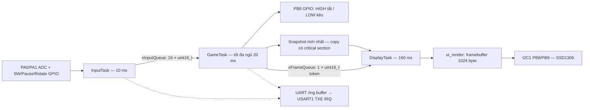

# Kiến trúc tổng quát

`main.c` khởi tạo board, kernel, hai Queue và ba Task; wrapper gọi các hàm `task_*_run`. Bốn lớp nguồn là BSP → HAL → middleware/API RTOS → application; quan hệ gọi thực tế là app gọi HAL/RTOS, HAL gọi ST HAL và BSP cung cấp cấu hình. Không phải chuỗi hàm gọi một chiều qua mọi lớp.

| Tài nguyên | Quyền sở hữu |
|---|---|
| ADC1/ADC2 và input GPIO | InputTask đọc; main cấu hình trước scheduler |
| Engine_t, board, FSM | GameTask duy nhất ghi |
| Buzzer PB6 | GameTask điều khiển; đường lỗi fatal được phép ép HIGH để tắt |
| Snapshot published | GameTask ghi, DisplayTask copy qua critical section |
| I2C1, OLED và framebuffer | DisplayTask độc quyền |
| UART debug | Nhiều Task ghi qua ring buffer được bảo vệ PRIMASK; ISR lấy byte |

Không có Task buzzer/UART riêng hoặc mutex I2C vì hiện chỉ một Task dùng bus. Critical section chỉ bao quanh copy snapshot ngắn, không bao quanh render/I2C. Kernel vẫn có Idle/Timer service nội bộ; “3 Task” ở đây là ba Task ứng dụng. HAL tick dùng TIM2; FreeRTOS tick dùng SysTick.

Đọc [kiến thức chung](learning/00_KIEN_TRUC_CHUNG.md) để hiểu startup, priority, stack/heap, contract Queue, timing và cách kiểm tra. [Phân công](TEAM_ASSIGNMENT.md) xác định người phụ trách từng Task. Chưa có kết quả nghiệm thu phần cứng cho bản hiện tại.
