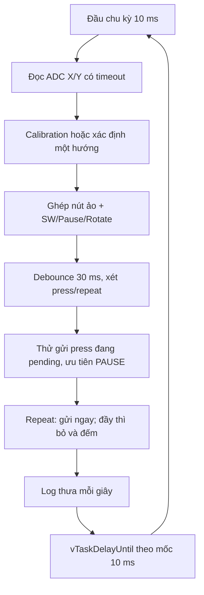

# 01 — TV1: InputTask

Task duy nhất phụ trách: `InputTask`. Học [phần chung](00_KIEN_TRUC_CHUNG.md) trước. Mục tiêu: giải thích vì sao một điện áp nhiễu trở thành đúng một sự kiện điều khiển, và không làm nghẽn scheduler khi Queue đầy.

## File đọc theo thứ tự

| File | Phần phải nắm |
|---|---|
| [task_input.c](../../app/src/task_input.c) | Vòng 10 ms, sáu mã logic, pending press, PAUSE ưu tiên, gửi Queue |
| [hal_joystick.c](../../hal/src/hal_joystick.c) | Start → Poll timeout → GetValue → Stop, chỉ trả cặp hợp lệ |
| [joystick_filter.c](../../app/src/joystick_filter.c) | Calibration, swap/invert, armed, hysteresis, khóa một trục |
| [joystick_config.h](../../app/inc/joystick_config.h) | Các tham số cần chỉnh theo module/lắp cần |
| [button_filter.c](../../app/src/button_filter.c) | Debounce, press/repeat, tick wrap |
| [hal_gpio.c](../../hal/src/hal_gpio.c) | Mapping index → pin, active-low và legacy buttons |
| [main.c](../../main.c), [main.h](../../bsp/inc/main.h) | ADC1 PA0/ADC2 PA1, ADC clock 12 MHz, sampling 55.5, pull-up SW |

UART là công cụ hỗ trợ chung: TV1 đọc thêm `app_log.c` và `hal_uart.c` để giải thích log từ nhiều Task, nhưng không có UART Task riêng.

## Luồng thuật toán

Trong code, vòng xử lý chạy PAUSE trước rồi đến các mã khác; không chờ cho Queue rỗng. Input không biết đang WELCOME, menu hay PLAYING, chỉ gửi mã logic. GameTask mới quyết định ý nghĩa từng mã theo màn hình.

## Các điểm phải giải thích được

- PA0/PA1 có giá trị 12-bit 0–4095; VCC joystick dùng 3.3V. Hardware ADC calibration ở main khác với lấy trung bình tâm joystick trong filter.
- 32 mẫu đầu (~320 ms) dùng cho tâm nếu nằm trong 1500–2600 và spread ≤120. Nếu đang gạt, fallback 2048, chờ về tâm. ADC lỗi nhả hướng và chờ rearm; không đồng nghĩa tự phát hiện dây analog bị đứt.
- Ngưỡng vào 700, nhả 400 tạo hysteresis; trong vùng giữa hai ngưỡng giữ hướng đã chọn. Gạt chéo chọn một trục rồi khóa tới khi trục đó nhả; không vừa xoay vừa đi ngang.
- Debounce yêu cầu cùng mức ít nhất 30 ms; chu kỳ lấy mẫu làm độ trễ thực tế có sai số theo nhịp 10 ms. Release vừa được lấy mẫu đã ngừng repeat, không đợi hết release debounce mới ngừng.
- `button_filter_step` trả 0/1/2 tương ứng none/press/repeat. LEFT/RIGHT/DOWN lặp sau 300 ms rồi mỗi 100 ms; UP/SW không lặp. Menu loại repeat ở GameTask.
- `pending` tối đa một press/mã, không phải buffer vô hạn. Press mới khi đã pending tăng bộ đếm mất; repeat không được tích hàng dài. PAUSE được thử trước khi có chỗ nhưng không chen đầu Queue.
- `vTaskDelayUntil` giữ mốc chu kỳ; `osMessageQueuePut(...,0,0)` không chờ Queue. Không sửa `game` hay gọi OLED ở Task này.

## Bài thực hành trên nhánh feature/task-input

1. Sau chạy `./tests/run_host.sh`, chạy lại `build/host/test_joystick`, `test_joystick_adc` và `test_joystick_task` để đọc từng nhóm PASS. Chỉ thực thi các binary sau khi đã build bằng script.
2. Vẽ bảng 8 mốc: thời gian, ADC X/Y, hướng, sample/stable, code gửi, bit repeat. Bắt đầu bằng giữ phải; đối chiếu press đầu và repeat.
3. Trên board, nếu gạt lên làm đi ngang, xác định cờ `SWAP_XY`; nếu hướng ngược, xác định cờ invert. Chỉ sửa cờ phù hợp, ghi raw ADC trước/sau và demo đủ bốn hướng. Cần đưa cần về tâm lúc reset.
4. Đề xuất một cấu hình vùng chết mới và giải thích tradeoff giữa nhạy và chống nhiễu. Làm trên nhánh, cập nhật test kỳ vọng theo yêu cầu mới rồi chạy tests; không đổi main tùy ý chỉ để test cũ PASS.
5. Mô phỏng Queue đầy bằng test mock: giải thích thứ tự PAUSE/SW khi có chỗ trở lại. Không cố tạo tải vô hạn trên kit để chứng minh.

Đầu ra: bảng mẫu, sơ đồ riêng, diff cấu hình nếu có, host log và UART/ảnh/video board nếu đã đo. Ghi rõ bài nào chỉ mô phỏng.

## Câu hỏi kiểm tra riêng

1. Vì sao không gửi ADC raw thẳng vào FSM? Cặp X hợp lệ/Y lỗi có được dùng không?
2. Calibration lúc đang gạt cần có làm hướng đó thành tâm mới không?
3. Tại ADC lệch 650 sau khi đã kích hoạt trái, filter trả gì? Tại lệch 350 thì sao?
4. Giữ SW hai giây có bao nhiêu press? Menu xử lý hold phải ra sao?
5. Mã RIGHT repeat là bao nhiêu ở dạng hex? Ai loại repeat trong menu?
6. Nếu chỉ mất OLED, InputTask có phải dừng không? Vì sao?
7. Pending press có thể trễ bao lâu nếu Queue luôn đầy? Có cam kết không mất mọi press không?
8. Tại sao tick wrap không làm deadline repeat chạy sai ngay lập tức?

TV1 hoàn thành khi giải thích được từ chân PA0 tới một mã trong Queue và tự tìm được lỗi nhầm pin, ngược trục, nhiễu tâm hoặc gửi repeat sai.
