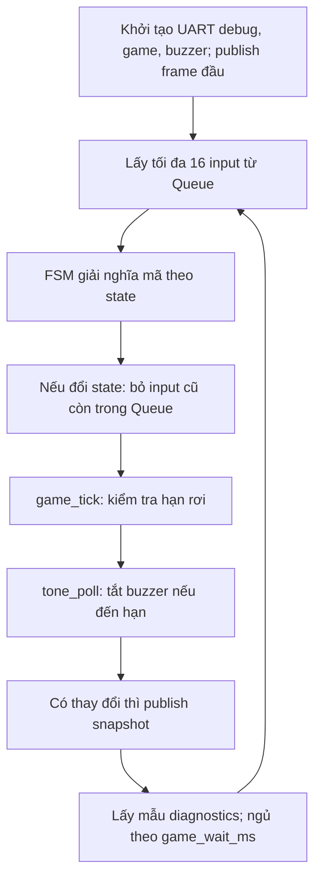

# 02 — TV2: GameTask

Task duy nhất phụ trách: `GameTask`. Học [phần chung](00_KIEN_TRUC_CHUNG.md) trước. Mục tiêu: nắm quyền sở hữu dữ liệu game, thuật toán Tetris, cách menu giải nghĩa input và cách xuất snapshot nhất quán cho màn hình.

## File đọc theo thứ tự

| File | Phần phải nắm |
|---|---|
| [task_game.c](../../app/src/task_game.c) | Nhận tối đa 16 event/vòng, tick, publish/copy snapshot, chờ deadline |
| [game_internal.h](../../app/inc/game_internal.h) | Engine_t, tọa độ khối, mask, board, state và deadline |
| [game_fsm.c](../../app/src/game_fsm.c) | Ý nghĩa phím theo state, pause/resume, menu, repeat |
| [game_engine.c](../../app/src/game_engine.c) | Sinh khối, collision, xoay, khóa, xóa hàng, điểm, gravity |
| [hal_buzzer.c](../../hal/src/hal_buzzer.c) | HIGH tắt / LOW bật, timeout không block |
| [app_diagnostics.c](../../app/src/app_diagnostics.c) | Heap, stack, timing và fatal mute |

## Luồng Task

Engine và FSM đều chạy trong ngữ cảnh GameTask, không phải các Task riêng. Các file tách ra để dễ học/test. Hàm `tone` trong host test là mock; firmware liên kết driver thật.

## Thuật toán cần hiểu

1. **Biểu diễn:** board 20×10 lưu ô đã khóa, 0 là rỗng, 1..7 là loại khối. Khối đang rơi là `mask` 4×4 với gốc `piece_x/piece_y`; mỗi bit biểu diễn một ô. `published` chèn khối rơi vào bản sao, không chèn vào board gốc.
2. **Di chuyển:** thử tọa độ mới bằng `can_place`, kiểm tra biên trước truy cập mảng, chỉ cập nhật khi không va chạm.
3. **Xoay:** bit (r,c) → (c,3-r). Khối O giữ nguyên; các khối khác thử dịch ngang 0,-1,+1,-2,+2 để tránh tường. Đây là wall-kick đơn giản, không phải full SRS.
4. **Khóa/xóa hàng:** ghi khối vào board; quét hàng từ dưới lên, bỏ hàng đầy, dồn hàng còn lại xuống rồi xóa phần trống trên cùng. Không bỏ sót hai hàng đầy liên tiếp.
5. **Điểm/kết thúc:** bảng 100/300/500/800 nhân level trước lần xóa. Level = lines/10+1. WIN khi score ≥1000 được xét trước spawn; spawn không hợp lệ mới là GAME_OVER. Gravity hiện cố định theo độ khó EASY 800/NORMAL 500/HARD 250 ms, không tự nhanh dần theo level.
6. **Thời gian:** `game_tick` cộng một gravity interval vào mốc cũ để giảm trôi thời gian. `game_wait_ms` ngủ tối đa 20 ms, ngắn hơn nếu sắp tới hạn. Resume đặt lại mốc để không tính thời gian pause thành thời gian rơi.

## FSM và đồng bộ

WELCOME → MAIN_MENU → DIFFICULTY → PLAYING; MAIN_MENU cũng vào HELP. PLAYING có PAUSED, WIN, GAME_OVER. Menu khác nhau có thao tác Back/OK cụ thể trong switch; đọc từng nhánh thay vì suy đoán mọi màn giống nhau.

Mã `BTN_ROTATE` là gạt lên hoặc nút xoay; SW là `BTN_DROP`. Repeat chỉ có hiệu lực ở PLAYING. Đổi state làm GameTask xả Queue input còn tồn; một lần gạt cũ không được tự chọn tiếp qua nhiều màn.

`publish_snapshot` chuẩn bị dữ liệu ngoài critical section, chỉ copy `published` và cờ ready trong đoạn bảo vệ. Queue frame chứa token, khi đầy snapshot vẫn được cập nhật. TV3 copy qua `app_game_copy_snapshot` dùng cùng critical section; không trả con trỏ `Engine_t` cho TV3.

Buzzer là module **active-low**: `tone(900,35)` nghĩa bật tiếng cố định khoảng 35 ms, không phải đảm bảo tần số 900 Hz. `tone(0,0)` tắt HIGH. `tone_poll` chạy trong vòng Task nên thời điểm tắt phụ thuộc lần poll tiếp theo. Không thêm delay chờ tiếng báo kết thúc.

## Bài thực hành trên nhánh feature/task-game

1. Chạy `./tests/run_host.sh`, sau đó `build/host/test_game` và `build/host/test_buzzer`. Giải thích mỗi assert quan trọng thay vì chỉ đọc PASS.
2. Tự đặt một bàn cờ tạo hai hàng đầy liên tiếp: viết ra board trước/sau `lock_piece`, điểm, lines, next state. Đối chiếu bằng host test.
3. Viết bảng mã LEFT/RIGHT/UP/DOWN/SW/PAUSE cho PLAYING và PAUSED, kiểm tra code xử lý LEFT Back/Resume.
4. Trên nhánh riêng, đề xuất thay ngưỡng WIN hoặc một giá trị độ khó; xác định test/README cần đổi và chứng minh chỉ TV2 sửa logic game, không sửa Input/OLED để bù.
5. Demo Pause một lúc rồi Resume không rơi bù ngay, hard drop một lần khi giữ SW, và buzzer im khi hết báo. Ghi rõ nếu mới có mock, chưa có board.

Đầu ra: sơ đồ FSM, minh họa mask 4×4, ví dụ xóa hàng/điểm, bản đồ quyền ghi dữ liệu và bằng chứng tests.

## Câu hỏi kiểm tra riêng

1. Vì sao board không chứa khối đang rơi trước khi khóa? Làm sai sẽ gây va chạm thế nào?
2. Tọa độ âm phải được xử lý trước khi ép sang `uint8_t` ở đâu?
3. Điểm khi xóa hàng thứ 10 dùng level nào? Độ rơi có tăng theo level không?
4. Khi vừa đạt WIN vừa không thể spawn, state cuối là gì?
5. Nếu token Queue đầy, Display có thấy snapshot mới không? Nếu chỉ xem `game` trực tiếp thì rủi ro gì?
6. Vì sao xử lý tối đa 16 input/vòng? Tại sao đổi state lại bỏ input cũ?
7. PAUSED có gọi gravity để khóa khối không? Resume cần thay mốc nào?
8. Vì sao dùng PWM duty 0 để tắt lại làm module `低电平触发` kêu?

TV2 hoàn thành khi tự lần được một event từ Queue tới thay đổi board/score/state, snapshot và tiếng báo, cùng các nhánh xử lý lỗi và timing liên quan.
