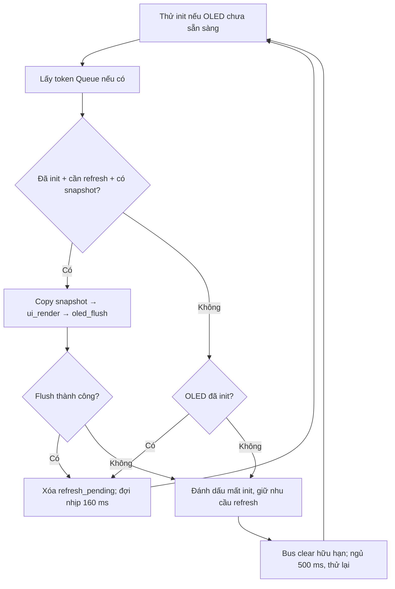

# 03 — TV3: DisplayTask

Task duy nhất phụ trách: `DisplayTask`. Học [phần chung](00_KIEN_TRUC_CHUNG.md) trước. Mục tiêu: giải thích cách một snapshot thành 1024 byte pixel, và cách OLED lỗi mà game vẫn tiếp tục xử lý.

## File đọc theo thứ tự

| File | Phần phải nắm |
|---|---|
| [task_display.c](../../app/src/task_display.c) | Init/retry, token, refresh_pending, copy/render/flush, nhịp vẽ |
| [app_shared.h](../../app/inc/app_shared.h) | GameSnapshot_t và API copy; không dùng game_internal |
| [ui_renderer.c](../../app/src/ui_renderer.c) | Pixel/page, font, draw_game_board và switch từng state |
| [hal_oled.c](../../hal/src/hal_oled.c) | Command/data, page addressing, timeout, clear bus |
| [stm32f1xx_hal_msp.c](../../bsp/src/stm32f1xx_hal_msp.c) | I2C1 remap PB8/PB9 |

## Luồng thuật toán

## Các điểm cần hiểu

- Queue frame chỉ chứa token `uint16_t`. Token không phải con trỏ frame; nội dung mới nhất được lấy bằng `app_game_copy_snapshot`. Nhận nhiều state nhanh có thể chỉ vẽ state mới nhất ở nhịp 160 ms; đây là cách cập nhật màn hình hiện tại.
- Critical section nằm trong API copy, kết thúc trước render/I2C. TV3 không khóa toàn bộ bus bằng tắt ngắt, không sửa board/FSM và không lấy `Engine_t`.
- OLED 128×64 có 8192 pixel, 1 bit/pixel → 1024 byte. Layout page: `index = x + (y/8)*128`, bit `y%8`. Với pixel (10,9), index = 138, mask = `0x02`.
- `ui_render` xóa buffer rồi vẽ theo state; font 5×7, bước ngang 6 pixel. Chuỗi quá dài bị cắt; board dùng tile 3×3 để 20 hàng vừa chiều cao 64 pixel. Preview dùng cùng thứ tự I/O/T/S/Z/J/L như engine.
- `oled_cmd` dùng control byte `0x00`; dữ liệu dùng `0x40`. SSD1306 địa chỉ 7-bit `0x3C`, đối số HAL là `0x3C<<1`. Chuyển qua 8 page, mỗi page 128 byte.
- I2C1 remap dùng PB8/PB9, cần pull-up mức 3.3V. Truyền frame ở 100 kHz mất cỡ 100 ms trên bus, chưa phải số đo board. Nhịp Display 160 ms hạn chế tải; không cố gửi ở nhịp Input 10 ms.
- `refresh_pending` chỉ xóa khi flush thành công. Lỗi truyền khiến init lại và giữ nhu cầu vẽ; bus clear tối đa 9 xung, tạo STOP rồi khôi phục HAL I2C. Khi lỗi, Task ngủ 500 ms để không chiếm CPU liên tục.
- HAL transmit đồng bộ có timeout từng lần truyền. Timeout này không đồng nghĩa WCET toàn bộ vòng vẽ; cần đo thực tế. Mất OLED không bắt GameTask chờ màn hình.

## Bài thực hành trên nhánh feature/task-display

1. Chạy `./tests/run_host.sh`; phần renderer hiện kiểm tra render các state an toàn trên host. Đó không phải bằng chứng hình ảnh trên OLED đúng từng pixel.
2. Tính bằng tay địa chỉ byte và bit của pixel (0,0), (127,63), (10,9). Giải thích cách `pixel` giới hạn tọa độ.
3. Trên nhánh riêng, đổi một chuỗi HELP cho vừa 128 pixel, hoặc thêm một thông tin có sẵn trong snapshot. Không đọc thêm biến private `game`. Chạy tests và chụp OLED nếu có board.
4. Tạo snapshot giả với một hàng gạch và next piece cụ thể, giải thích buffer mong muốn. Nếu bổ sung test pixel, kiểm tra yêu cầu hiển thị thực tế thay vì chỉ lặp lại công thức của implementation.
5. Trên kit, thử reset khi OLED chưa kết nối, rồi nối đúng nguồn/mass/tín hiệu và quan sát khả năng phục hồi theo hướng dẫn phần cứng của nhóm. Không chập bus cố ý. Đối chiếu `TIMING_OLED` và việc input/game vẫn hoạt động.

Đầu ra: sơ đồ render/flush/retry, ví dụ byte pixel, bảng màn hình của tám state, ảnh/demo thực tế hoặc ghi rõ chưa có phần cứng.

## Câu hỏi kiểm tra riêng

1. Vì sao màn 128×64 chỉ cần 1024 byte? Một byte là một hàng 8 pixel ngang hay một cột 8 pixel dọc?
2. Khác nhau giữa địa chỉ 7-bit 0x3C và đối số 0x78 cho HAL là gì?
3. Vì sao Queue frame chỉ cần một token? Nếu token đầy có cần reset Queue không?
4. Bản sao frame local có bị GameTask sửa lúc đang render không?
5. Vì sao `refresh_pending` không được xóa trước khi biết flush thành công?
6. Khi SDA kẹt LOW, bus clear làm gì? Có bảo đảm cứu mọi lỗi phần cứng không?
7. Nếu muốn vẽ thêm điểm cao nhất nhưng snapshot chưa chứa, cần phối hợp TV2 và sửa contract thế nào?
8. Vì sao không tăng priority Display cao hơn Input chỉ để màn hình mượt hơn?

TV3 hoàn thành khi tự giải thích được từ token/snapshot tới pixel và I2C, xác định được lỗi nhầm địa chỉ/remap/font/overflow chuỗi, cùng nhánh retry khi mất OLED.
